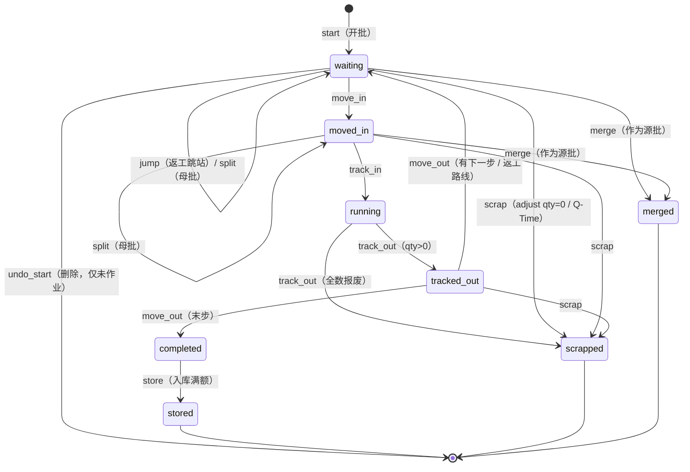
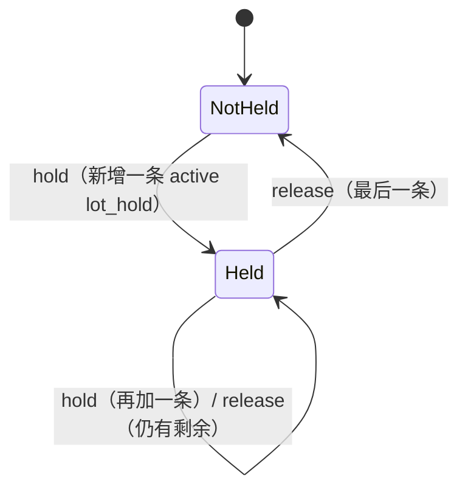

# fsft 批次状态机集中设计（优化清单第 3、4、5 项）

> 状态：v0.2，已按 decisions.md D1–D11 及「测试评审 19 处问题的处理」修订（P01–P19） · 作者：CIM 架构师 · 2026-10-13
> 依据：`/workspace/fsft/backend/app/mes` 源码（只读）、`knowledge/lot-lifecycle.md`。
> 原则：**以现有代码的状态集为准，不改业务语义**，只把分散的判断和写入收拢到一处。

## 1. 现有状态字段

| 字段 | 定义位置 | 取值 |
|---|---|---|
| `lot.lot_status` | `lot/specs.py:314`，枚举 `lot_status` 在 `lot/specs.py:229` | waiting, moved_in, running, tracked_out, completed（待入库）, stored, scrapped, merged |
| `lot.on_hold` | `lot/specs.py:320` | bool，冗余标志，应等于"存在 is_active 的 lot_hold" |
| `lot_hold.is_active` | `lot/specs.py:439` 起 | 每条 Hold 一行，多原因并存 |
| `lot.pending_rework` | track_out.py:274 写 | Track Out 判返工后，Move Out 走返工路线 |
| `wafer.wafer_status` | `lot/specs.py` 枚举 `wafer_status` | waiting, processing, rework, completed, scrapped |
| `lot_history.from_status / to_status` | `lot/lots.py:49` 默认 to_status=当前 lot_status | 历史 |
| 常量 | `lot/lots.py:18` `TERMINAL=(completed, stored, scrapped, merged)`；`execution/constants.py` `FROM_STATUS/TO_STATUS/NEXT_STAGE`；`execution/sm_rules.py:22` `SPLIT_STATES=(waiting, moved_in)`；`warehouse/service.py:43` `RECEIVABLE="completed"` |

另有工单状态 `work_order.wo_status`（`planning/service.py:40` 有自己的 `transition` 表，含 hold/resume），不在本文范围，但模式相同，可后续套用。

注意：代码模型是 **四段式** 过站（Move In → Track In → Track Out → Move Out），比 knowledge 笔记里的 Waiting/InProcess 两段式更细。本文以代码为准。另外 `completed` 在 TERMINAL 中，但仍可 `→ stored`，所以它是"流程终态、仓储非终态"。

## 2. 现有改状态的位置（文件:行）

| 动作 | 写 lot_status / on_hold | 前置判断位置 |
|---|---|---|
| 开批 start | `planning/service.py:504-523` 直接 `sa.insert(lot)`，`lot_status=waiting, on_hold=False` | planning 内 |
| 撤销开批 | `planning/service.py:617` 直接 DELETE lot | `:610` 要求 waiting 且非 hold 且无非 start 历史；**未加锁读取**（`:592`） |
| Move In | `execution/stages.py:69-79` waiting→moved_in | `stage_common.py:25-31` `_guard` |
| Track In | `execution/stages.py:150-162` moved_in→running；`:149` wafer→processing | `_guard` + `stages.py:104-130` |
| Track Out | `execution/track_out.py:265-278` running→tracked_out 或 →scrapped（全报废）；`:211/245/262` wafer | `_guard` |
| Move Out | `execution/stage_common.py:82-94` tracked_out→waiting(下一步) 或 →completed（末步）；`:86/93` wafer | `_guard`；`stages.py:228` rework_count |
| 自动推进 | `execution/stages.py:301-310` `run_stage` 循环调用上面四个 | `:303` on_hold/NEXT_STAGE |
| 批量过站 | `execution/batch.py:44,66` 逐批 `run_stage`，失败 `s.rollback()` | `:44` NEXT_STAGE |
| Hold | `execution/hold.py:80-96` 插 lot_hold、`on_hold=True` | `hold_lot` 自身不判状态；`manual_hold` `:198` 判 TERMINAL |
| Release | `execution/hold.py:153-172` 先改 lot_hold，**再** `lock_lot`（:165），重算 on_hold | `:146` is_active |
| 批量 Release | `execution/hold.py:291-317` 逐条调用 release_hold | — |
| Split | `execution/split.py:143-157` `_ins` 子批，`lot_status` 经 `sm_rules.COPY` 复制母批，`on_hold=bool(holds)`；`:168` 复制 hold；`:204` 母批 qty | `split.py:98` SPLIT_STATES |
| Merge | `execution/merge.py:200-212` 源批→merged；`:240` 目标批 qty | `merge.py:150-164`（SPLIT_STATES、无 hold） |
| 数量调整/报废 | `execution/adjust.py:128,136` qty=0 时→scrapped | `adjust.py:68` TERMINAL |
| Q-Time 超时报废 | `execution/qtime_actions.py:100-119` →scrapped | 无状态校验（仅查超时） |
| Q-Time 超时 Hold | 经 `hold_lot` | — |
| 返工跳站 jump | `execution/rework.py:119` 改 current_step（状态保持 waiting） | `rework.py:83-93` |
| 换载具/分拣 | `execution/carrier.py:93,256` 只改 carrier_id | `carrier.py:71,219` 非 TERMINAL 且非 running |
| 入库 | `warehouse/service.py:262-263` completed→stored | `warehouse/service.py:93-95` RECEIVABLE 且非 hold |
| ECN 切换路线 | `process/ecn.py:108-137` 读状态，改路线 | ecn 内 |

问题汇总：
1. 合法性判断散落 10+ 处，各自用 `TERMINAL / SPLIT_STATES / FROM_STATUS / RECEIVABLE` 不同常量。
2. `hold_lot` 不校验终态（qtime/dc 自动 Hold 可能 Hold 一个 scrapped 批次）；qtime 报废不校验当前状态（running 中能被报废？）。
3. `on_hold` 标志在 hold.py 两处和 split.py 一处手工维护，没有统一重算。
4. 加锁：`merge.py:141-145` 先锁目标批再按请求顺序锁源批；`release_hold` 先写 lot_hold 再锁 lot；`warehouse` 按入库单行顺序锁；`undo_start` 不加锁。→ 多批次操作存在死锁和竞态风险。
5. 没有"撤销 Track In（Abort）"，按现状不新增，列入待决问题。

## 3. 目标状态模型

两个正交维度：**流程状态 `lot_status`** + **Hold 标志 `on_hold`（由 active lot_hold 推导）**。



Hold 维度：



## 4. 合法转移表

`H` = 是否允许在 on_hold=True 时执行。

| 动作 | 允许的起始状态 | 目标状态 | H | 备注 |
|---|---|---|---|---|
| start | （无） | waiting | — | 仅 create_lot |
| undo_start | waiting | （删除） | 否 | 且无非 start 历史 |
| move_in | waiting | moved_in | 否 | |
| track_in | moved_in | running | 否 | |
| track_out | running | tracked_out / scrapped | **是**（D2）| 改变现代码 `_guard` 对 Hold 一律拒绝的行为 |
| move_out | tracked_out | waiting / completed | 否 | |
| jump（返工跳站） | waiting | waiting | 否 | |
| split | waiting, moved_in | 母批不变；子批=母批状态 | 是 | 子批继承 active hold；子批按现有 `sm_rules.COPY` 复制母批的 step/路线/进站设备等上下文（P12）；拆出数量须 ≥1 且 < 母批数量，母批不得剩 0（P13） |
| merge（源） | waiting, moved_in | merged | 否 | 目标与源须同状态同站点；源列表去重前有重复 id、或源包含目标 → 422 `lot_status`（P14） |
| merge（目标） | waiting, moved_in | 不变 | 否 | |
| adjust（报废至 0） | 非 TERMINAL 且 ≠ running | scrapped | 是 | D3 禁 running；报废后遗留 active Hold 的处理见 P15（待 kai mi 定） |
| adjust（部分/加数） | 非 TERMINAL | 不变 | 是 | |
| qtime_scrap | waiting | scrapped | 是 | 现 qtime 只扫 waiting 批次（qtime_actions.py:156），固化 |
| change_carrier / sort | 非 TERMINAL 且 ≠ running | 不变 | 是 | |
| priority | 非 TERMINAL | 不变 | 是 | |
| hold | 非 TERMINAL | 不变，on_hold=True | 是 | **新增校验**（D4）：手动来源 → 422；自动来源（qtime/dc/spc 等）→ 不抛异常，返回 `skipped`、记 warning 日志、不写 lot_hold/history/事件（P11） |
| release | 任意（含全部终态，P05） | 不变，重算 on_hold | 是 | 终态批次的遗留 Hold 允许解除，只关闭 lot_hold、不改 lot_status。hold_id 不存在/非本租户 → 404；hold 已解除 → 422（N10） |
| store | completed | stored（满额）/ 不变（部分） | 否 | |

**所有不在表里的组合一律拒绝**，抛 `IllegalTransition(action, from_status, on_hold)` → HTTP 422。错误码（P01）：**因批次处于 Hold 而被拒时沿用现有 `on_hold`**，其余状态不合法一律 `lot_status`；两者同时不满足时优先报 `lot_status`。

### 4.1 幂等（P02）
写接口（move_in/track_in/track_out/move_out、hold/release、split/merge、adjust、jump、carrier、undo_start、store、批量接口）支持**可选**请求头 `Idempotency-Key`（≤128 字符）：
- 按 `(tenant_id, key)` 存于 `app/core/idempotency.py` 的 `idempotency_key` 表：`key, tenant_id, method, path, request_hash, status_code, response_body JSONB, created_at`，保留 24 小时（每日清理）。
- 同键重试且请求体哈希相同 → 直接返回首次的状态码与响应体，不再执行业务、不再写事件；同键但请求体不同 → 422 `idempotency_key_mismatch`；首次请求仍在执行 → 409 `idempotency_in_progress`。
- 记录与业务写入**同一事务**提交（失败的请求不记录，可以重试）；只记录 2xx 与 4xx 业务结果，不记录 5xx。
- 不带键：保持现有行为（第二次提交按状态检查返回 422）。
- 用例 C02 分两条：带键 → 两次返回相同 200 且只生效一次；不带键 → 一次 200 一次 422。

## 5. 集中实现接口

位置：`app/mes/lot/state.py`（新），经 `lot/service.py` 导出。

```python
# app/mes/lot/state.py
from enum import StrEnum

class LotStatus(StrEnum):
    WAITING="waiting"; MOVED_IN="moved_in"; RUNNING="running"; TRACKED_OUT="tracked_out"
    COMPLETED="completed"; STORED="stored"; SCRAPPED="scrapped"; MERGED="merged"

TERMINAL = frozenset({COMPLETED, STORED, SCRAPPED, MERGED})   # 兼容现有 TERMINAL

@dataclass(frozen=True)
class Rule:
    from_: frozenset[LotStatus]      # 允许的起始状态
    to: LotStatus | None             # None = 状态不变；多目标时由调用方传 to 并校验 ∈ targets
    targets: frozenset[LotStatus] = frozenset()
    allow_hold: bool = False

RULES: dict[str, Rule] = {...}       # 即 §4 表格，唯一事实来源

class IllegalTransition(MesError): ...

def check(lot: Row, action: str, to: LotStatus | None = None) -> LotStatus:
    """纯函数：校验并返回目标状态，不碰数据库。便于单测穷举。"""

def transition(s, tid, lot: Row, action: str, user, *, to=None,
               history: dict | None = None, **vals) -> Row:
    """唯一允许写 lot.lot_status 的函数：
    1. 要求 lot 已被本事务 lock（调用方用 lock_lot/lock_lots 取得）
    2. check() 校验
    3. _upd(lot, lot_status=..., **vals)，更新内存行
    4. 写 lot_history(from_status, to_status, action)
    5. 写 audit
    6. 按 EVENTS[action] 映射（domain-events.md §4，过去式）emit 0..n 条事件；
       每 emit 一条 row_version += 1，事件 version 取新值；映射为空的动作不加版本（P04/P07/P08）
    不 commit。"""

def recompute_hold(s, tid, lot: Row, user) -> bool:
    """唯一允许写 lot.on_hold 的函数：按 active lot_hold 重算。
    每次 hold/release 都调用，无论 on_hold 是否变化都发 lot.held/lot.released 并 row_version+1（P06）。"""

def lock_lots(s, tid, ids: Iterable[UUID]) -> dict[UUID, Row]:
    """按 id 升序 SELECT ... FOR UPDATE 一次取全；缺失抛 404。"""
```

各调用点改造：`_guard`、`SPLIT_STATES`、`RECEIVABLE`、`FROM_STATUS` 判断全部替换为 `state.check(...)`；`_upd(..., lot_status=...)` 和 `_upd(..., on_hold=...)` 全部替换为 `transition` / `recompute_hold`。`execution/constants.py` 的 `NEXT_STAGE` 只保留给 UI 提示和自动推进用，由 RULES 推导生成。

守护：表归属检查脚本（见 module-boundaries.md §4.2）额外规则——`lot_status=` / `on_hold=` 关键字只允许出现在 `lot/state.py`、`lot/lots.py(create)`。

## 6. 加锁顺序规则

1. **同一事务内锁多个批次，必须一次性 `lock_lots(sorted(ids))`**，不得逐个按业务顺序锁。适用：merge（目标+源一起排序）、split（母批；子批是新行无需锁）、warehouse `_validate_all/_post`、批量 hold/release、undo_start。
2. **跨表顺序固定**：`work_order → lot（按 id）→ lot_hold → wafer → carrier/tool/equipment`。`release_hold` 改为：先读 hold 拿 lot_id → `lock_lot` → 再 `SELECT lot_hold FOR UPDATE` 并检查 is_active → 再写（修正现 `hold.py:153→165` 的倒序和重复释放竞态）。
3. **批量接口逐条提交的**（batch.py、release_batch）：每条一个 savepoint（`s.begin_nested()`），失败只回滚该条；不再用 `s.rollback()` 回滚整个会话。
4. 锁等待超时：PG 设 `lock_timeout = '5s'`（会话级），超时转 HTTP 409 `lot_busy`"批次正被其他操作占用"。等到锁后再做状态检查，状态已变 → 422（P16）。并发用例 C01/C03 断言结果 ∈ {422, 409}，且恰好一个成功；正常 5s 内应为 422，409 只做计数不算失败。
5. 只读查询（报表、看板）不加锁。

## 7. 给测试评审的用例清单

### 7.1 纯函数（`state.check`，参数化穷举）
- T01 对 8 个状态 × 全部动作 × on_hold∈{T,F} 穷举，结果与 §4 表一致（表驱动测试，表即 RULES 的独立副本）。
- T02 每个终态（completed/stored/scrapped/merged）上执行 move_in/track_in/split/merge/hold → 拒绝。
- T03 completed→store 允许；stored→store 拒绝。
- T04 track_out 只允许目标 ∈ {tracked_out, scrapped}；传 completed 拒绝。

### 7.2 服务层合法路径（DB）
- T10 start→move_in→track_in→track_out→move_out(中间步)→…→move_out(末步)=completed→store=stored，每步 lot_history 的 from/to 正确。
- T11 track_out 全数报废 → scrapped，wafer 全部 scrapped。
- T12 move_out 返工 → waiting，rework_count+1，pending_rework 清零。
- T13 split 在 waiting / moved_in：子批状态=母批、子批继承 active hold、母批 qty 减少。
- T14 merge：源批 merged、qty=0；目标 qty 累加；谱系记录。
- T15 adjust 报废到 0 → scrapped。
- T16 hold 两次 → on_hold=T；release 一条 → 仍 T；release 第二条 → F。
- T17 warehouse 部分入库 → 仍 completed；满额 → stored。
- T18 undo_start 对未作业批次删除成功。

### 7.3 非法转移（必须 422 且数据库无变化、无 history、无 outbox 事件）
- N01 waiting 直接 track_in / track_out / move_out。
- N02 moved_in 执行 move_in（重复进站）。
- N03 running 执行 split / merge / jump / change_carrier。
- N04 on_hold 的批次 move_in / track_in / move_out / merge / jump / store。
- N05 merged 批次除 release 外的任何写操作（含 hold）。release 对终态允许，见 §4（P05）。
- N06 scrapped 批次 hold（自动 Hold 来源 qtime/dc 也要拒绝）——**现代码会放行，属行为变更**。
- N07 merge 源与目标状态不同（waiting vs moved_in）。
- N08 completed 批次 move_in；stored 批次 store。
- N09 undo_start 已 move_in 的批次 / 有 hold 的批次。
- N10 release 已解除的 hold。
- N11 绕过检查：直接 `_upd(lot, lot_status=...)` 出现在 state.py 外 → 静态检查脚本失败（CI 用例）。

### 7.4 并发（第 4 项，需 PG，两个连接/线程；CI 用 postgres service 跑，P19）
- C01 两个会话同时 move_in 同一批次 → 一个成功，一个 422（状态已变）。
- C02 同一请求重复提交 track_out → 只生效一次；带同一 Idempotency-Key 两次均返回首次结果，不带键第二次 422（P02）。
- C03 A 合并 [L1←L2]，B 同时合并 [L2←L1] → 无死锁（依赖排序加锁），一个成功一个 422。
- C04 merge 与 split 同时作用于同一批次 → 串行化，结果一致（qty 守恒：Σqty 不变）。
- C05 release_hold 并发释放同一 hold → 只释放一次，history 只一条。
- C06 hold 与 track_in 并发 → 要么 hold 先生效 track_in 被拒，要么 track_in 先成功后 hold 成功（running 允许 hold），不出现 on_hold 与 lot_hold 不一致。
- C07 warehouse 两张入库单包含相同批次、行顺序相反，同时过账 → 无死锁。
- C08 batch track_in 中一批失败 → 其他批次已提交的不回滚（savepoint）。

### 7.5 不变量（每个测试后断言，可做成 fixture）
- I1 `lot.on_hold == exists(active lot_hold)`。
- I2 终态批次无 active 的进站上下文（equipment_id/exec_ctx 为空）。
- I3 merged 批次 qty=0 且无未报废 wafer。
- I4 每次状态变化恰有一条 lot_history，from_status≠to_status 或 action 属于不变状态动作。

## 8. 落地顺序
1. 测试先行：测试评审按 §7.1/7.3 写用例（对现有代码先跑，记录哪些失败 = 现有缺陷基线）。
2. 后端新增 `lot/state.py` + `lock_lots`，先只替换判断（`_guard` 等），不改写入。
3. 再替换写入点（§2 表逐行勾掉），同时加静态检查。
4. 加锁顺序改造 + 并发用例。

## 9. 需要 kai mi 决定（Q1–Q6 已于 2026-10-13 按建议定稿，见 decisions.md D1–D6；新增待定见 decisions.md P15）
- Q1 状态集维持现有 8 个（四段式）不变？还是要合并 moved_in/tracked_out？建议**不变**。
- Q2 running 中被 Hold 的批次能否 Track Out？现代码拒绝（必须先 release）。行业常见做法是允许完成当前加工再停在下站前。建议**允许 track_out，禁止 move_out**。
- Q3 running 批次能否通过 adjust 报废到 0 / 被 Q-Time 报废？建议**禁止**。
- Q4 终态批次能否被 Hold（现自动 Hold 不拦）？建议**禁止**。
- Q5 是否新增 Abort（撤销 Track In：running→moved_in）？现代码没有。建议**本期不做**，列入后续。
- Q6 `completed` 是否继续算 TERMINAL（影响看板 WIP 统计）？建议维持现状。

## 10. 补充规则（测试评审 19 处问题，详见 decisions.md）
- 每次 transition 可发多条事件，例如 track_out 全报废：先 `lot.tracked_out`（to_status=scrapped），再 `lot.terminated{to_status:scrapped, reason:track_out_all_scrap}`，row_version +2（P04）。
- undo_start：删除前对已锁批次发 `lot.creation_reverted`，row_version+1（P09）。
- start：row_version 由 0 变 1，`lot.created` 的 version=1（P18）。
- D10（路由层提交）落地前后，事务相关用例（R 组）按阶段用 `xfail(strict=True, reason="待 D10")` 标记，D10 合入时去掉标记（P17）。
