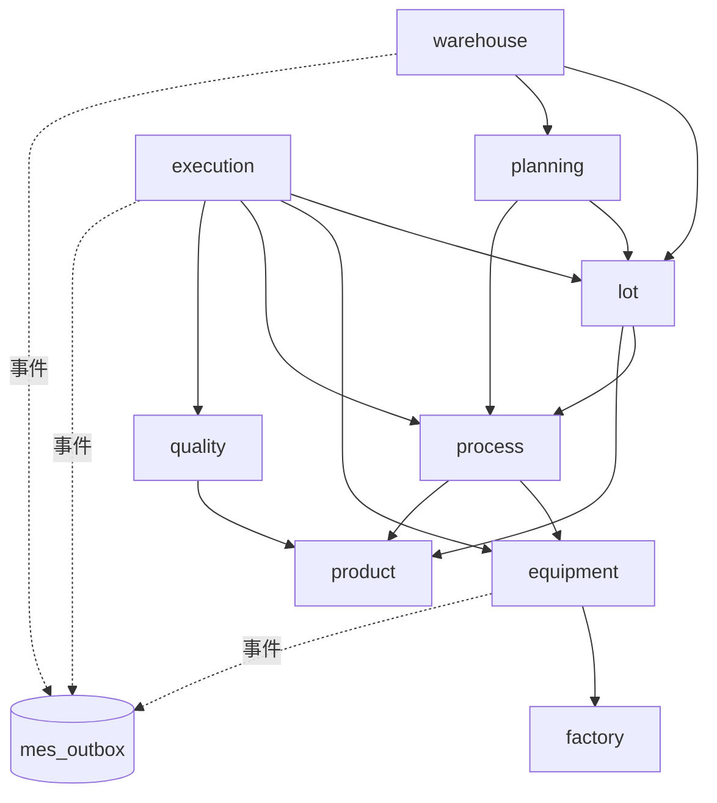

# fsft MES 模块边界设计（优化清单第 2 项）

> 状态：草案 v0.1，待 kai mi 确认 · 作者：CIM 架构师 · 2026-10-13
> 范围：`/workspace/fsft/backend/app/mes`。只读分析，未改任何代码。
> 完整交叉引用清单见同目录 `module-boundaries-appendix-xref.txt`（脚本扫描，227 行）。

## 0. 先更正之前群里的两个说法

读完代码后，有两点和第一轮快速扫描的结论不一样，必须先更正：

1. **"跨模块 import models" 基本不存在。** 这个项目没有按模块分的 ORM models。表结构由各模块 `specs.py` 里的 `Entity(...)` 注册到全局 `app.core.spec.engine.TABLES / ENTITIES`，业务代码用 **表名字符串** 访问：`one(s, tid, "lot", id)`、`find(...)`、`_upd(s, tid, "lot", ...)`、`TABLES["lot"]`。
   跨模块的 Python import 已经比较规整，几乎都是 `from app.mes.<x>.service import ...`（各模块都有 `service.py` 作为门面）。
   **真正的耦合在"按表名字符串直接读写别的模块的表"**，import-linter 这类工具看不到这层。
2. **生产代码里没有 warehouse→execution 依赖。** 唯一一处是测试：
   `mes/warehouse/tests/test_receiving.py:8  from app.mes.execution.tests.test_exec import API, Line`
   ——warehouse 的测试复用了 execution 测试里的夹具。warehouse 生产代码只依赖 `lot.service`（`warehouse/service.py:31`）并直接写 `lot` / `work_order` 表。

## 1. 现状

### 1.1 表归属（按 `specs.py` 注册位置）

| 模块 | 拥有的表 |
|---|---|
| common | dict_type, dict_item, code_rule, code_rule_counter, attr_def |
| factory | site, area, workcenter, shift, work_calendar, calendar_day |
| product | uom, uom_conversion, tech_node, product_family, product, material_type, material, carrier_type, carrier, carrier_event, reticle, fixture, material_lot |
| process | operation, route, route_step, step_resource, product_route, recipe, recipe_equipment, param_spec, change_order |
| quality | measurement_item, dc_plan, dc_plan_item, sampling_rule, defect_code, reason_code, dc_result |
| equipment | equipment_type, equipment_group, e10_state, e10_transition, equipment, equipment_capability, tool, e10_auto_rule, e10_history, pm_plan, pm_record, downtime |
| planning | work_order |
| lot | lot_priority, lot_type, split_merge_rule, qtime_rule, **lot, wafer, lot_hold, lot_history, lot_recipe_run, lot_genealogy** |
| execution | check_rule, check_plan, check_plan_item, check_binding, check_log, future_hold, shift_log, operator_qual |
| warehouse | warehouse, storage_location, receipt, receipt_line |

注意：`lot/specs.py` 中 `lot` 实体的第二个参数是 `"wo"`，`lot_hold` 是 `"exec"`（菜单/分组标签），和物理所在模块不一致，需在迁移时确认归属（建议以文件所在模块为准）。

### 1.2 跨模块 Python import（排除 demo.py 和 tests）

全部走对方 `service`，方向如下：

| 调用方 → 被调方 | 位置（文件:行） | 引用 |
|---|---|---|
| execution → lot | future_hold.py:15, split.py:30, priority.py:17, adjust.py:17, context.py:18, track_out.py:24, reports.py:23, stages.py:27, merge.py:30, stage_common.py:16, hold.py:18, rework.py:18, qtime_actions.py:24, dispatch.py:15, carrier.py:21, checks/service.py:48, checks/types.py:11 | TERMINAL, history, lock_lot, units, qtime_status |
| execution → equipment | track_out.py:15, reports.py:22, stages.py:16, qtime_actions.py:17, dispatch.py:13, checks/service.py:3,6, checks/types.py:8 | e10_apply, e10_current, pm_status, pm_notify, tool_life |
| execution → process | context.py:19, stage_common.py:17, qtime_actions.py:26 | step_after, next_location, apply_due |
| execution → quality | context.py:20, track_out.py:25 | sampling, out_of_spec |
| execution → planning | qtime_actions.py:25 | wo_due_notify |
| planning → lot | service.py:31, board.py:12 | lot_svc, TERMINAL |
| planning → process | service.py:33 | process_svc |
| process → equipment | validators.py:14 | check_recipe_equipment_type |
| warehouse → lot | service.py:31 | lot_svc |
| **warehouse(tests) → execution(tests)** | warehouse/tests/test_receiving.py:8 | API, Line 夹具 |
| mes/demo.py → 全部 | demo.py | 演示数据，豁免 |

结论：import 层面没有环。`qtime_actions.py`（execution）调 `planning.service.wo_due_notify` 和 `equipment.service.pm_notify`，是"定时任务挂在 execution 里顺便通知别的模块"，属于职责放错位置。

### 1.3 按表名的跨模块读写（真正的耦合）

扫描规则：`one/find/_upd/_ins/get_row/TABLES["x"]` 第一个字符串参数是别的模块的表（common 除外）。

| 调用方 → 表所属模块 | 次数 | 其中写操作 |
|---|---|---|
| execution → lot | 73 | `_upd(lot)`：hold.py:95,171；stages.py:147,228；stage_common.py:94；split.py:204；adjust.py:136；priority.py:57；carrier.py:93,256。`_upd(wafer)`：stages.py:149；stage_common.py:86,93；track_out.py:262；carrier.py:91,253。另有 split.py:143/168 `_ins` 子批与晶圆、merge.py:193 直接 `sa.update(TABLES["wafer"])`、merge.py:200/240 `_upd(lot)`、track_out.py:265 `_upd(lot)`、qtime_actions.py:100/109 `_upd(wafer/lot)` |
| execution → process | 30 | 只读 |
| execution → product | 29 | `_upd(carrier)`：carrier.py:95,97,257,259；usage.py:29 |
| execution → equipment | 17 | `_upd(tool)`：stages.py:145；track_out.py:201 |
| execution → quality | 11 | 只读 |
| execution → factory | 5 | 只读 |
| planning → lot | 8 | service.py:504 `sa.insert(TABLES["lot"])`、:538 更新 tracking_level、:617 **直接 DELETE lot** |
| planning → process / product | 5 / 1 | 只读 |
| warehouse → lot | 3 | service.py:263 `_upd(lot)`（置 stored） |
| warehouse → planning | 3 | service.py:295 `_upd(work_order)`（完工数） |
| equipment → lot | 2 | e10.py:43 读 lot（判断同机台是否还有 running 批次）；maint.py 读 lot_history（PM 计数） |
| process → lot / planning | 3 / 1 | ecn.py 读 lot / work_order |
| quality → lot | 1 | dc.py 读 lot_history |

**结论**：`lot` 表被 execution、planning、warehouse 三个模块直接写；`work_order` 被 warehouse 直接写；`carrier`、`tool` 被 execution 直接写。这是状态机分散（见 `lot-state-machine.md`）和事件难以统一发出的根源。

## 2. 目标依赖规则

### 2.1 分层（只允许上层依赖下层，同层禁止互相依赖）

```
L4  warehouse            ─┐
L3  execution            ─┤ 流程编排层（可调用 L0-L2 的 service）
L2  planning   lot       ─┘ 
L1  process  quality  equipment
L0  factory  product  common     （主数据）
基础设施: app.core / app.platform（任何层可用）
```



说明：
- `planning → lot`：开批由 planning 编排，但 **建 lot 行必须调用 `lot.service.create_lot()`**，不再自己 `sa.insert`。
- `warehouse → execution`：**不允许**。warehouse 需要的只是"批次可入库/置为 stored"，由 lot 提供。
- `equipment → lot`：现 e10.py:43 读 lot 表是反向依赖（L1 读 L2）。改为由调用方 execution 传入 `others_running: int`，或 lot 提供 `lot.service.running_count(equipment_id)` 并由 execution 传给 equipment。推荐前者，equipment 完全不感知批次。
- `process/ecn.py`、`quality/dc.py`、`equipment/maint.py` 读 lot/work_order/lot_history：改为调用 `lot.service` / `planning.service` 的查询函数。

### 2.2 两条硬规则

1. **Python import**：跨模块只能 `from app.mes.<x>.service import ...` 或 `from app.mes.<x> import service`。禁止 import 其他模块的 `lots.py / hold.py / specs.py / validators.py` 等内部文件。`tests/` 之间禁止互相 import，公共夹具上移到 `app/testing/mes` 或 `backend/conftest.py`。
2. **表访问**：一个模块只能对 **自己拥有的表** 做写操作（`_ins/_upd/_del/sa.insert/update/delete`）。跨模块读：短期允许（报表、看板查询太多，一次改不完），新代码一律走对方 service；长期把只读查询收进对方的 `queries`。

### 2.3 各模块对外 service 接口清单（目标）

已有的保留，**加粗为新增**。签名统一 `(s, tid, ..., user)`，**不在内部 commit**（事务由路由层/用例层统一提交，见 domain-events.md §3）。

| 模块 | service 接口 |
|---|---|
| lot | 现有：TERMINAL, history, lock_lot, units, create_units, tracking_level, qtime_clock, qtime_status。**新增**：`lock_lots(ids)`（按 id 排序加锁）、`create_lot(...)`、`delete_unstarted(ids)`、`transition(lot, action, **vals)`（状态机唯一入口）、`set_hold_flag(lot)`（由 lot_hold 重算）、`update_units(lot_id, status)`、`move_units(src, target)`、`get(id)` / `query(...)`、`running_count(equipment_id)` |
| equipment | 现有：e10_apply, e10_change, e10_current, pm_status, pm_complete, pm_notify, equipment_board, tool_life, check_recipe_equipment_type。**新增**：`tool_mount(tool_ids, equipment_id)` / `tool_release(...)`（替代 execution 写 tool 表）；`e10_apply` 参数加 `others_running` |
| product | **新增**：`carrier_assign(carrier_id, lot_id)`、`carrier_release(...)`、`carrier_count_use(...)`（替代 execution 写 carrier 表） |
| process | 现有：apply_due, enter_route, next_location, pop_route, route_steps, step_after, reorder_steps。不变 |
| quality | 现有：dc_plan_for, out_of_spec, sampling。**新增**：`lot_dc_results(lot_id)`（替代 dc.py 读 lot_history 的反向需求时由 lot 提供） |
| planning | 现有：transition, plan, start, undo_start, first_step, default_route, cap。**新增**：`add_completed_qty(wo_id, n)`（替代 warehouse 写 work_order）、`wo_due_notify` 保留 |
| execution | 现有门面：build_ctx, context, hold_lot, manual_hold, release_hold, release_batch, list_holds 等。只给路由层和 warehouse 以外的上层用 |
| warehouse | transition, receivable, pending_qty（只被路由层调用） |

## 3. 拆掉 warehouse→execution（及 warehouse 写别人的表）

1. **测试夹具**：把 `execution/tests/test_exec.py` 里的 `API`、`Line` 抽到 `app/testing/mes/fixtures.py`（`app.testing.mes` 已存在，被引用 9 次），execution 和 warehouse 的测试都从这里 import。
2. **置 stored**：`warehouse/service.py:262-263` 改为 `lot.service.transition(lot, "store", stored_at=at)`，由状态机校验 `completed → stored`。
3. **完工数**：`warehouse/service.py:295` 改为 `planning.service.add_completed_qty(wid, n)`。
4. **加锁顺序**：`_validate_all`（:235）和 `_post`（:253）按 receipt_line 创建顺序逐个 `lock_lot`，改为先 `lot.service.lock_lots(sorted(ids))` 一次锁全（见状态机文档 §6）。
5. 加 import-linter 契约（下节）防止回退。

## 4. 检查工具配置

### 4.1 import-linter（`pyproject.toml`）

```toml
[tool.importlinter]
root_packages = ["app"]
include_external_packages = false

[[tool.importlinter.contracts]]
name = "MES 分层"
type = "layers"
containers = ["app.mes"]
layers = [
  "warehouse",
  "execution",
  "planning | lot",          # 同层且互相独立（需 import-linter >= 2.1）
  "process | quality | equipment",
  "factory | product",
  "common",
]
ignore_imports = [
  "app.mes.demo -> app.mes.**",          # 演示数据豁免
  "app.mes.*.demo -> app.mes.**",
  "app.mes.planning.service -> app.mes.lot.service",  # planning 编排开批，过渡期显式白名单
]

[[tool.importlinter.contracts]]
name = "跨模块只能走 service"
type = "forbidden"
source_modules = ["app.mes.execution", "app.mes.planning", "app.mes.warehouse", "app.mes.process", "app.mes.quality", "app.mes.equipment"]
forbidden_modules = [
  "app.mes.lot.lots", "app.mes.lot.qtime", "app.mes.lot.specs",
  "app.mes.equipment.e10", "app.mes.equipment.maint", "app.mes.equipment.status",
  "app.mes.process.navigation", "app.mes.process.ecn", "app.mes.quality.dc",
]
# 注：各模块对自己内部文件的 import 需用 ignore_imports 或拆成每模块一条契约，
#     实际落地时用脚本按模块生成。

[[tool.importlinter.contracts]]
name = "测试之间不互相依赖"
type = "independence"
modules = ["app.mes.execution.tests", "app.mes.warehouse.tests", "app.mes.lot.tests",
           "app.mes.planning.tests", "app.mes.equipment.tests"]
```

> 实际 `layers` 写法以安装版本文档为准；`planning | lot` 若版本不支持，可退化成 `"planning"`、`"lot"` 两层（planning 在上）。

CI 中：`uv run lint-imports`（放进第 1 项的 GitHub Actions）。

### 4.2 表写入归属检查（import-linter 管不到，需自写）

`scripts/check_table_ownership.py`：用 `ast` 遍历 `app/mes/**/*.py`（排除 tests、demo），找 `_ins/_upd/_del` 调用和 `sa.insert/update/delete(TABLES["x"])`，若表 `x` 不属于当前模块且不在白名单 → 退出码 1。表归属从 `ENTITIES[x]` 注册时所在文件推导，白名单用于迁移过渡期，逐步清零：

```python
ALLOW = {  # 过渡期白名单，每完成一步删一行
    ("execution", "lot"), ("execution", "wafer"), ("execution", "carrier"),
    ("execution", "tool"), ("planning", "lot"), ("warehouse", "lot"),
    ("warehouse", "work_order"),
}
```

可选：用 `ruff` 的 `flake8-tidy-imports.banned-api` 禁止在非 lot 模块 import `app.core.spec.engine.TABLES`（太强，只建议最后一步启用）。

## 5. 分步迁移顺序

每步一个 PR，前提是第 1 项测试基线+CI 已就绪，每步跑全量测试不回退。

| 步 | 内容 | 风险 |
|---|---|---|
| 1 | 抽测试夹具到 `app/testing/mes`，去掉 warehouse→execution 测试依赖；加 import-linter（只开"测试独立"和"分层"两个契约，现状应直接通过）| 低 |
| 2 | 加表归属检查脚本 + 现状白名单，CI 中启用，冻结新增越权写 | 低 |
| 3 | lot 新增 `lock_lots / transition / set_hold_flag / update_units / move_units / create_lot / delete_unstarted`（与第 3 项状态机同一批做）| 中 |
| 4 | execution 的 hold/stages/stage_common/track_out/split/merge/adjust/rework/qtime_actions/carrier/priority 改调 lot.service；白名单删 `(execution, lot)`、`(execution, wafer)` | 中高，靠状态机测试兜底 |
| 5 | planning.start/undo_start 改用 `create_lot / delete_unstarted`；warehouse 改用 `transition("store")` 和 `add_completed_qty`；白名单删对应行 | 中 |
| 6 | equipment 去掉对 lot 表的读取（e10_apply 参数化）；execution 写 tool/carrier 改调 equipment/product service | 低 |
| 7 | 去掉 service 内部 `s.commit()`，统一由路由层提交（为 outbox 同事务做准备，见 domain-events.md）| 中高（批量操作 batch.py 依赖逐批 rollback，需改成 savepoint）|
| 8 | 跨模块只读查询逐步收进对方 service（报表、看板最后做，不阻塞）| 低 |

## 补充：基础设施表归属（P02）
`idempotency_key`（幂等键，24 小时）与 `mes_outbox` 一样属于 `app/core`，不归任何 mes 模块；只能经 `app/core/idempotency.py`（路由层依赖）读写，并加入表归属检查脚本的规则。
